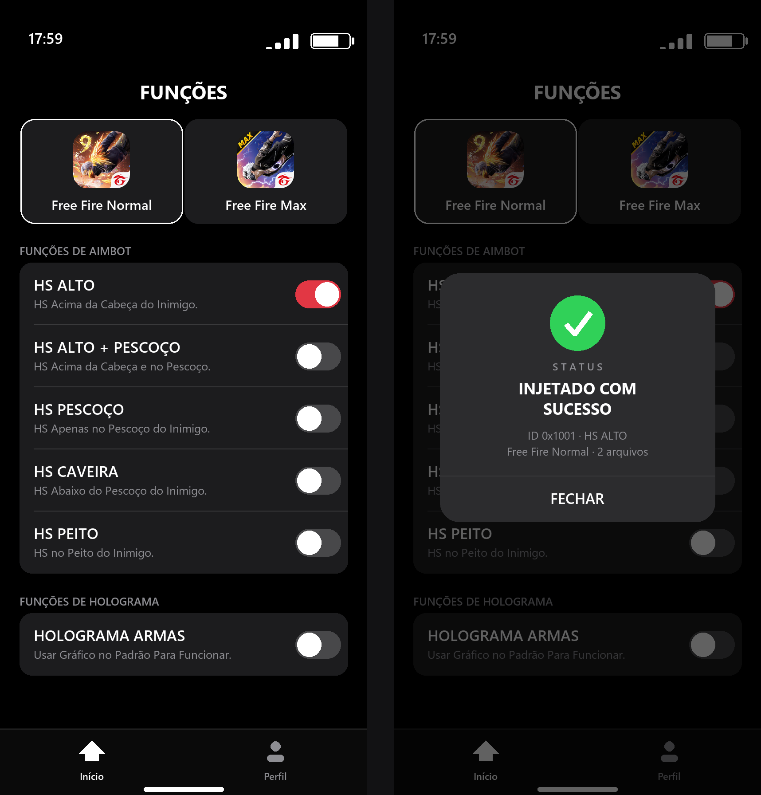

# EXTERNAL iOS 1.2.0 — KeyAuth v2

Esta versão substitui a autenticação antiga pelo login próprio de keyauthv2.org,
fixado no pacote EXTERNAL/external1. A biblioteca anterior não é baixada nem ligada.
A interface só abre após assinatura ES256 e introspecção online aceitas.
As ativações revalidam a licença; restauração de arquivos originais mantém seu fluxo.

O app exige assinatura iOS válida para Keychain/Secure Enclave. O IPA gerado sem
certificado é unsigned. Keys já vinculadas a outro esquema de instalação podem
precisar de reset de HWID. Nenhum token administrativo é embutido no login.

O catálogo /3106 continua sendo o serviço existente: sua proteção de acesso no
servidor é uma alteração separada. Não há promessa de bloqueio absoluto de patches.

## Histórico do projeto (pode descrever versões anteriores)

# FFPatch — patch por arquivo cru do container, com catálogo remoto

App iOS em **Objective-C puro** que aplica arquivos dentro do container de
`com.dts.freefireth` e `com.dts.freefiremax`: sem pacote `.3105`, sem Swift, sem
payload dentro da IPA. Os payloads vivem no **site de catálogo** em `ffpatch-site/`;
o app baixa o arquivo cifrado (AES-256-CBC + HMAC), decifra em
memória, confere SHA-256 e substitui no container — com backup verificado e
restauração exata.

A lógica inteira roda dentro de **`ffpatch.dylib`**. O binário principal da IPA é
um stub `MH_EXECUTE` de 60 linhas (`launcher/main.c`) que abre a dylib e chama
`FFAppMain()`.

Base herdada do [3106](https://github.com/QuinnTang74/3106) (fork do
[3105](https://github.com/YangJiiii/3105), GPL-3.0): `mcm_bridge`, `bad_query`,
`worse_query`, cadeia `kexploit_opa334 + sandbox_escape` e a política de versões.
O motor de patch é o `PatchTransaction.swift` portado para ObjC e refeito para
payload cru. Atribuição em [NOTICE.md](NOTICE.md).

---

## 1. Estrutura

```
fftools/                              (este projeto = app)
├── Sources/
│   ├── FFCore / FFSandbox / FFContainerStore     acesso + IO + digest
│   ├── FFManifest / FFPatchEngine                catálogo → manifest → transação
│   ├── FFCatalogClient                           baixa catálogo + packs FPP1
│   ├── FFCrypto                                  AES-256-CBC + HMAC (decodifica)
│   ├── FFProtect                                 mascaramento de config + anti-debug
│   ├── FFLicense / FFAppDelegate / entry.m
│   ├── UI/  FFTheme · FFWidgets · FFHome · FFProfile
│   └── Vendor/  20 arquivos C/ObjC do 3106 (GPL)
├── launcher/main.c        stub MH_EXECUTE (dlopen + FFAppMain)
├── Resources/
│   ├── Info.plist · License.plist · Catalog.plist (URL/segredo mascarados)
│   ├── Assets/           2 ícones de jogo (192 px)
│   └── Assets.xcassets/  AppIcon 60@2x, 60@3x, 1024
├── Scripts/  build_ipa.sh · build_theos.sh · package_ipa_theos.sh
│            protect_config.py · verify_project.py · make_icons.py · make_mockup.py
└── .github/workflows/build.yml     workflow GitHub Actions

ffpatch-site/                         (site do catálogo, zero dependência)
├── server.js              Node >= 18, node:http puro
├── lib/  crypto.js (FPP1) · zip.js (leitor ZIP) · store.js (JSON atômico)
├── public/  painel admin (HTML/CSS/JS)
├── scripts/selftest.js    teste E2E do site (roda sozinho)
└── README.md
```

## 2. Fluxo de ativação

```
app abre
 1. FFProtectInstall()            anti-debug + config mascarada
 2. backend de sandbox inicia sozinho, silencioso:
      iOS 17/18      → kexploit_opa334 + sandbox_escape (10–30 s)
      26.0–26.6.1    → bad_query
      26.7+/27.x     → worse_query (App Group)
 3. FFCatalogClient GET <site>/api/catalog
      baixa cada pack .fpp → HMAC → AES-256-CBC → SHA-256 → grava cópia decifrada
      no próprio container: Application Support/FFPatch/Catalog/<fn>/<game>/<path>
 4. manifest é montado em memória apontando para essa pasta (nada no IPA)

toggle ON
 5. resolve o container do jogo (índice worse_query → MCM → metadata plist)
 6. descobre o alvo (locate):
      path          caminho exato do payload
      name          VARRE o container e acha o arquivo pelo nome
      path-or-name  caminho exato se existe; senão varre; senão cria
 7. backup de cada alvo (SHA-256) + journal "prepared"
 8. grant no diretório pai → temporário → fsync → rename → confere SHA-256
  9. journal "applied" + recibo → alerta nativo: INJETADO COM SUCESSO
    falhou em qualquer passo → rollback exato
```

Varredura: BFS na raiz do container (ou `locate.roots`), pula
`Library/Caches`, `tmp`, `SplashBoard`, `Saved Application State`, `Logs`,
profundidade 8, teto 400.000 entradas, até `maxMatches` alvos, nome
case-insensitive, symlink nunca é alvo.

## 3. UI



- **Início (grade)**: `FUNÇÕES`, cards FF Normal / FF Max (borda branca no
  selecionado), seções por grupo, linhas com toggle.
  - ligado → **verde preenchido** (`UISwitch` verde);
  - durante a operação → spinner; ao final → alerta padrão do iOS com
    `INJETADO COM SUCESSO` / `RESTAURADO COM SUCESSO` e botão `Fechar`;
  - erro → mensagem curta em português, sem ID interno/código técnico na tela;
  - função publicada em manutenção aparece como `EM MANUTENÇÃO`, desligada;
  - função que só existe para o outro jogo fica oculta.
- **Perfil (pessoa)**: chave, duração, status, package, versões compatíveis,
  build, modelo, iOS/build e backend; **SINCRONIZAR CATÁLOGO**,
  **RESTAURAR ORIGINAIS** e **EXPORTAR DIAGNÓSTICO**.

## 4. Backends por versão

| Faixa | Backend | Quem inicia |
| --- | --- | --- |
| iOS 17.0–17.7.x (exceto A10) | `kernel` | automático no boot |
| iOS 18.0–18.7.1 | `kernel` | automático no boot |
| iOS 26.0–26.6.1 | `bad_query` | automático no boot |
| iOS 26.7–26.7.2 | `worse_query` | automático (precisa App Group na assinatura) |
| iOS 27.0–27.2 | `worse_query` | automático |
| iOS 27.3 beta 1 (`24C5037i`) | `worse_query` | automático (build-gated) |
| iOS 18.7.2+ / 27.3 beta 2+ | — | recusa explícita com motivo |

Não existe mais botão de desbloqueio: tudo começa sozinho, sem UI. Se o backend
falhar, o toast de erro só aparece quando você tenta usar uma função.

## 5. Build

### 5.1 Theos (Linux / WSL / macOS / device)

Theos compila a dylib e o stub, mas **não gera IPA** (`make package` gera deb).
O projeto encadeia o empacotador:

```bash
export THEOS=~/theos
./Scripts/build_theos.sh
# 1. make raiz → ffpatch.dylib
# 2. make launcher → ffpatch_launcher
# 3. package_ipa_theos.sh → Payload/FFPatch.app + IPA unsigned
./Scripts/build_theos.sh --no-ipa     # só compilar
```

### 5.2 macOS com Xcode CLT

```bash
./Scripts/build_ipa.sh
# CODESIGN_IDENTITY="Apple Development: ..." ./Scripts/build_ipa.sh
# OUTPUT_VERSION=1.1.0 ./Scripts/build_ipa.sh
```

### 5.3 Sem Mac

Push e baixe o artifact do workflow `.github/workflows/build.yml`
(`runs-on: macos-26`).

Saída sempre: `build/FFPatch-<versão>-unsigned.ipa`.

### 5.4 Configurar o catálogo antes do build

```bash
python Scripts/protect_config.py --url https://keyauthv2.org/3106 --secret-env MASTER_SECRET
```

Grava `baseURLMasked`/`masterSecretMasked` em `Resources/Catalog.plist` e remove
os valores em claro. O segredo precisa ser idêntico ao `MASTER_SECRET` do
servidor, senão o HMAC dos packs não confere. No workflow, o valor vem do GitHub
Actions Secret `MASTER_SECRET`; a URL pública está declarada no workflow. Não comite
uma configuração de produção nem o arquivo `.env` do servidor.

## 6. Site do catálogo

`ffpatch-site/` — Node >= 18, **zero dependências**:

```bash
cd ffpatch-site
export ADMIN_TOKEN="token-forte-do-painel"
export MASTER_SECRET="segredo-de-32-bytes-compartilhado-com-o-app"
export PUBLIC_URL="https://keyauthv2.org/3106"
export HOST=127.0.0.1
node server.js                                # http://127.0.0.1:8787
node scripts/selftest.js                      # teste E2E completo
```

Painel em `https://keyauthv2.org/3106/`: token → lista de funções → editar nome/subtítulo/grupo/status →
marcar para quais jogos vale → definir `locate` → **substituir payload** (upload
de ZIP com a árvore do container) → **remover payload** → excluir função →
editar bundles dos jogos. Cada ação entra na auditoria; a versão do catálogo
incrementa e o app vê na próxima sincronização.

API pública: `GET /api/catalog`, `GET /f/<fileId>.fpp`. Admin exige header
`x-admin-token`.

Formato do ZIP que você sobe (árvore = caminho relativo dentro do container):

```
Documents/ffpatch/hs_alto.cfg
Documents/ffpatch/hs_alto.json
```

Integridade: o servidor cifra cada arquivo em FPP1, calcula SHA-256 e faz
round-trip de decifragem antes de publicar — pack que não abre nunca entra no
catálogo.

## 7. Proteções (escopo honesto)

- **Nenhum payload na IPA**: o que fica no app é a URL/segredo mascarados; os
  bytes chegam cifrados do site e são decifrados em memória.
- **FPP1**: AES-256-CBC + HMAC-SHA256, chave derivada de `MASTER_SECRET` +
  `functionID` + `gameID`. Pack adulterado ou segredo diferente = recusa.
- **Config mascarada** (XOR com chave derivada do índice) — `protect_config.py`.
- **Build endurecido**: `-fvisibility=hidden`, `-Wl,-x`, `-Wl,-dead_strip`,
  `strip -x` no empacotamento.
- **Anti-debug** (`ptrace PT_DENY_ATTACH` + checagem `P_TRACED`), compilado com
  `-DFF_ENABLE_ANTIDEBUG=1`; `FFPATCH_DEBUG=1` desliga para desenvolvimento.
- **IPA limpa**: sem README, sem coleção de logos (só 2 ícones de jogo e 3 de
  springboard), sem arquivos de payload.

Limite que não vou vender como outro: app sideloaded pode ser dumpado. Isso
eleva o custo, não cria cofre. O valor real protegido é o payload, e ele não
existe dentro da IPA.

## 8. Limites

- Não é jailbreak: não instala bootstrap/daemon nem injeta código no jogo.
- A cadeia de kernel herdada ainda precisa de validação em aparelho; esta build
  serializa a ativação e bloqueia uma segunda tentativa na mesma sessão.
- Reinstalar o jogo muda o fingerprint do container: o restore recusa escrever
  no container novo em vez de arriscar estado inconsistente.
- iOS 26.7+/27 exige App Group na assinatura (AltStore/SideStore/Sideloadly);
  certificado `.p12` + profile wildcard não carrega App Group.
- Feche o Free Fire antes de aplicar.

## 9. Verificação

`docs/VERIFICACAO.md` lista o que foi provado nesta máquina (sintaxe ObjC,
shellcheck, selftest do site, cross-check do FPP1, plists/manifest/ícones) e o
que só fecha com Mac/aparelho.

## 10. Licença

GPL-3.0. Componentes de terceiros mantêm suas licenças — [LICENSE](LICENSE),
[NOTICE.md](NOTICE.md).


## 11. Correções 2026-11-23 (backend / exploit)

O resolvedor de container agora usa o banco do `lsd` (`FFLaunchServicesStore`)
antes do MCM — é o único caminho que resolve `bundle id → container` em
iOS 26.7+/27 quando o MCM recusa e o metadata plist é root-owned. Todos os grants
do worse_query passam por um lock recursivo (o swap de `Library/Caches` não é
reentrante; grants em paralelo eram a causa de instabilidade), a transação de
patch mantém **um** token do container do backup até a escrita, e a cadeia de
kernel ganhou crash guard (não repete sozinha depois de um reboot no meio).

Detalhes, diagnóstico do log e como validar:
[docs/CORRECAO-EXPLOIT-2026-11-23.md](docs/CORRECAO-EXPLOIT-2026-11-23.md)

Perfil → **REATIVAR ACESSO** limpa o crash guard e roda a ativação de novo.